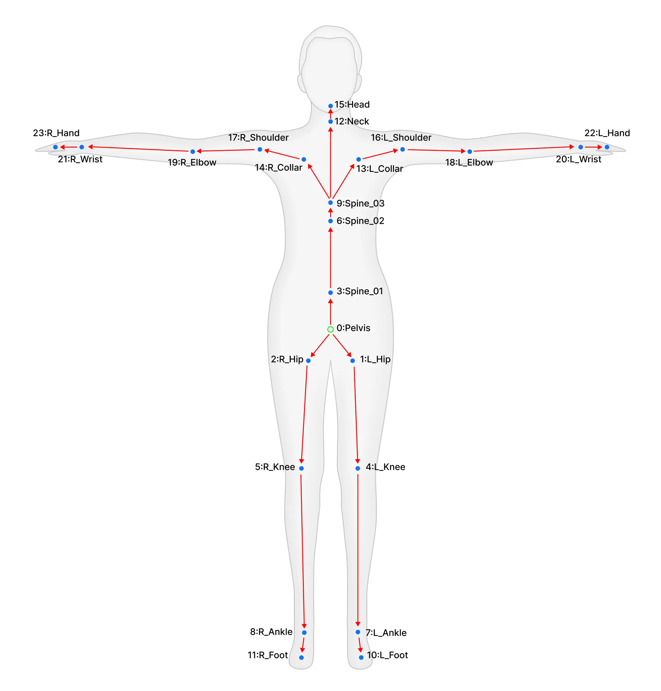
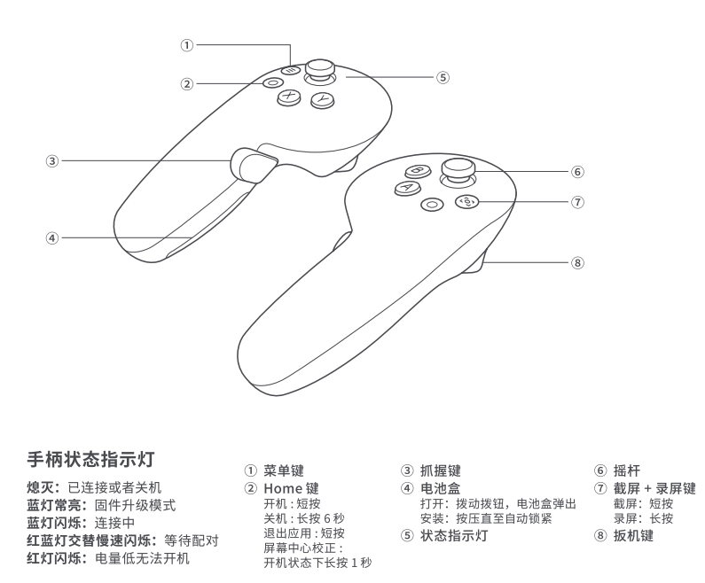

# Pico-Body-Tracking-Server


## Getting started

1. 运行服务器

先运行 roscore
```bash
roscore
```

再运行服务器
```bash
python3 body_tracking_server.py
```

2. 启动 PICO VR 中 **Pico-Body-Tracking-Demo** 项目

    2.1 按照指示校准传感器（如果校准完进入APP后没有任何UI反馈，请重新进入 **Pico-Body-Tracking-Demo** APP）

    2.2 进入 **Pico-Body-racking-Demo** APP 后，在左侧 UI 在线列表选择已上线的机器人服务器

    2.3 点击左侧 UI 中的 **连接** 按钮

    2.4 连接后，点击左侧 UI 中的 **开始遥操作** 按钮，此时 APP 会把 full-body-tracking-pose 发送到机器人服务器


3. 可视化

```bash
rviz
```

启动 `rviz` 后，更改 `Global Options` 中的 `Fixed Frame` 为 `world`，然后添加 `TF` 选项，就可以看到 full-body-tracking-pose **的实时可视化**

## full-body-tracking-pose 说明


人体参考图：




full-body-tracking-pose 的骨骼节点说明：
```python
body_tracker_role = [    
    "Pelvis",
    "LEFT_HIP",
    "RIGHT_HIP",
    "SPINE1",
    "LEFT_KNEE",
    "RIGHT_KNEE",
    "SPINE2",
    "LEFT_ANKLE",
    "RIGHT_ANKLE",
    "SPINE3",
    "LEFT_FOOT",
    "RIGHT_FOOT",
    "NECK",
    "LEFT_COLLAR",
    "RIGHT_COLLAR",
    "HEAD",
    "LEFT_SHOULDER",
    "RIGHT_SHOULDER",
    "LEFT_ELBOW",
    "RIGHT_ELBOW",
    "LEFT_WRIST",
    "RIGHT_WRIST",
    "LEFT_HAND",
    "RIGHT_HAND",
]
```

手柄参考图：

  


## 录制播放功能

### 录制功能
使用 `robot_pico_recorder.py` 脚本可以录制机器人控制数据，支持录制以下话题：
- `/ik/two_arm_hand_pose_cmd` - 双臂手部位姿命令
- `/mm/two_arm_hand_pose_cmd` - 移动操作手部位姿命令  
- `/humanoid_mpc_foot_pose_target_trajectories` - 人形机器人足部轨迹

#### 录制命令
```bash
# 录制控制数据到指定bag文件
python3 robot_pico_recorder.py record <bag文件名>

# 示例：录制到 my_control_session.bag
python3 robot_pico_recorder.py record my_control_session.bag
```

### 播放功能
播放录制的控制数据，自动调用必要的控制服务：
- `/change_arm_ctrl_mode` - 切换手臂控制模式
- `/mobile_manipulator_mpc_control` - 启用移动操作MPC控制
- `/enable_mm_wbc_arm_trajectory_control` - 启用手臂轨迹控制

#### 播放命令
```bash
# 播放录制的bag文件
python3 robot_pico_recorder.py play <bag文件名>

# 示例：播放 my_control_session.bag
python3 robot_pico_recorder.py play my_control_session.bag
```

### 使用场景
- **动作录制**: 录制复杂的机器人操作序列
- **动作回放**: 重复执行录制的操作
- **教学演示**: 录制标准操作流程用于教学
- **调试分析**: 录制问题场景用于后续分析

### 注意事项
- 录制时确保网络连接稳定
- 播放前检查机器人状态和安全
- 录制的bag文件包含时间戳信息
- Ctrl+C中断录制/播放


## 接口文档

详情见 docs/api_docs.md, [文档链接](./docs/api_docs.md)

