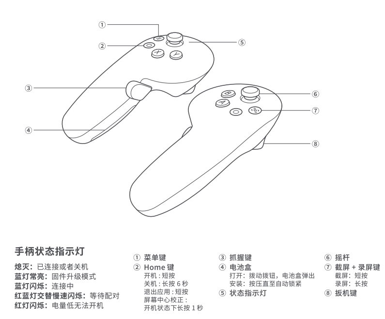

# 数据格式约定文档

## Socket 数据格式

### 手柄数据

- `controllers.left.primaryButton`: 主按钮 (X)
- `controllers.left.secondaryButton`: 副按钮 (Y)
- `controllers.left.gripButton`: 握把按钮
- `controllers.left.triggerButton`: 扳机按钮
- `controllers.left.gripValue`: 握把值 (0.0 到 1.0)
- `controllers.left.triggerValue`: 扳机值 (0.0 到 1.0)
- `controllers.left.thumbstick`: 摇杆位置 [x, y] (-1.0 到 1.0)
- `controllers.right.primaryButton`: 主按钮 (A)
- `controllers.right.secondaryButton`: 副按钮 (B)
- `controllers.right.gripButton`: 握把按钮
- `controllers.right.triggerButton`: 扳机按钮
- `controllers.right.gripValue`: 握把值 (0.0 到 1.0)
- `controllers.right.triggerValue`: 扳机值 (0.0 到 1.0)
- `controllers.right.thumbstick`: 摇杆位置 [x, y] (-1.0 到 1.0)

## ROS 数据格式

### topics

#### PICO 手柄数据

话题名称: `/pico/joy`

话题描述: 发布 PICO 左右手柄数据

数据类型: `sensor_msgs/Joy`

| 字段 | 类型 | 描述 |
|------|------|------|
| header | std_msgs/Header | 消息头部，包含时间戳和坐标系信息 |
| buttons | int32[] | 按钮状态数组，0表示未按下，1表示按下 |
| axes | float32[] | 轴数据数组，包含摇杆位置和握把/扳机值 |

- buttons 顺序: 
   - X 按键     primaryButton
   - Y 按键     secondaryButton
   - 左握把按钮  gripButton   
   - 左扳机按钮  triggerButton
   - A 按键     primaryButton
   - B 按键     secondaryButton
   - 右握把按钮  gripButton
   - 右扳机按钮  triggerButton
- axes 顺序:
  - 左摇杆位置 thumbstick_x
  - 左摇杆位置 thumbstick_y
  - 左握把值   grip_value
  - 左扳机值   trigger_value
  - 右摇杆位置 thumbstick_x
  - 右摇杆位置 thumbstick_y
  - 右握把值   grip_value
  - 右扳机值   trigger_value

  